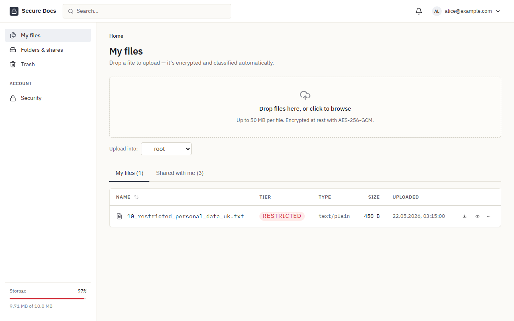
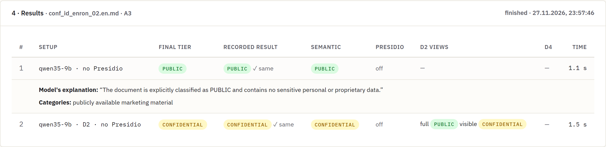

# Secure Document Storage

[](https://github.com/G0frik/secure_electronic_document_storage/actions/workflows/ci.yml)

A web service for storing documents in which access depends on content. Every uploaded file version is classified into one of four tiers (PUBLIC, INTERNAL, CONFIDENTIAL, RESTRICTED), and role-based policies check that tier on every download, preview and share.



## What it does

- **Classification.** Text is extracted in memory from 24 file types; DOCX and PDF yield a full view (tables, headers, comments, metadata, hidden text) and a visible view. A semantic classifier (zero-shot NLI with DeBERTa-v3-large or bge-m3, or a local LLM through llama.cpp) is combined with Presidio, including Ukrainian РНОКПП, passport and +380 recognizers; the higher tier wins.
- **Prompt-injection defenses**, enabled with `CLASSIFIER_DEFENSES`: `D1` hardened LLM prompt, `D2` classify both views and keep the higher tier, `D4` injection detector as a gate, `D6` normalize obfuscated identifiers before Presidio.
- **Access control.** Roles admin, user and guest; policies per role, department or group, with a single decision point and deny by default. Unclassified files are visible only to their owner.
- **Sharing.** User and folder shares; external links store only a token hash, expire, and re-check the current version's tier on every download.
- **Encryption.** AES-256-GCM with a per-file data key wrapped by a KEK from HashiCorp Vault; plaintext never touches disk.
- **Accounts.** Argon2id, minimum 15 characters, Have I Been Pwned check, optional TOTP with recovery codes, server-side sessions in Redis, CSRF protection, rate-limited login.
- **TLS.** nginx 1.28 with OpenSSL 3.5 prefers the hybrid post-quantum group X25519MLKEM768 and falls back to X25519.
- **Audit.** Every policy decision and file action is logged; events are also written as ECS JSON lines for a SIEM ([docs/siem](docs/siem) has Filebeat and Wazuh configs).

## Run

Requires Docker with Compose v2. The first build pulls PyTorch and spaCy, and the first classification downloads the NLI model (about 1.7 GB, cached in a volume).

```bash
cp .env.example .env
cp .env.init.example .env.init      # secrets loaded into Vault; set KEK for anything beyond local use
docker compose up -d --build
docker compose exec backend flask seed-dev    # departments and the users below
docker compose exec backend flask seed-demo   # sample files, shares, a share link
```

Open https://localhost and accept the self-signed certificate.

| Account | Password | Role |
|---|---|---|
| admin@example.com | `ChangeMeNow123!` | admin |
| alice@example.com | `AlicePassword123!` | user, marketing |
| bob@example.com | `BobPassword123!` | user, HR manager |
| carol@example.com | `CarolPassword123!` | user, engineering |
| dave@example.com | `DavePassword123!` | guest |

Local-only endpoints: MinIO console http://localhost:9001, MailHog http://localhost:8025, Vault https://localhost:8200, Postgres localhost:5432.

### Using a local LLM

Set `CLASSIFIER_ENGINE=llm`, `LLM_BASE_URL` and `LLM_MODEL` in `.env` and run `llama-server` on the host; setup and models are described in [backend/research/README.md](backend/research/README.md). If the server is unreachable, classification fails instead of defaulting to PUBLIC.

### Admin playground

`make playground` starts the stack with an admin-only page that runs one document through several classifier setups and attacks side by side; `make playground-down` returns to the normal stack. It needs the same host servers as the LLM mode. Playground runs never change real files.



## Development

```bash
make test        # backend tests in the container (536)
make coverage    # tests with a coverage report
make lint        # ruff, mypy, eslint
make migrate     # alembic upgrade head
make shell-db    # psql
make clean       # stop and delete volumes
```

CI runs lint and tests for both halves, gitleaks over the full history, and a fresh-clone start of the whole stack. Install git hooks with `pre-commit install`.

```
backend/app/        Flask API, services (policy.py is the decision point), classifier_core, Celery tasks
backend/research/   experiment harness for classifiers and attacks
frontend/src/       React + TypeScript
docker/             nginx, Vault and Postgres setup
```

`classify_sensitivity.py` classifies local files without the stack.

## Limitations

- Files are encrypted and classified in memory, so uploads are capped at 50 MB.
- No OCR: scanned PDFs and text in images are not classified.
- Blobs record their KEK version, but there is no rotation command yet.
- The UI shows only the current version's tier.
