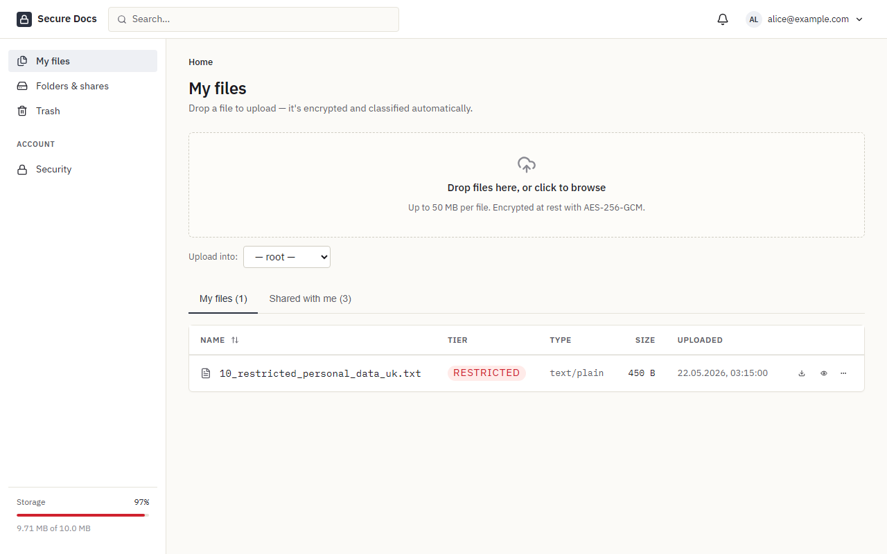
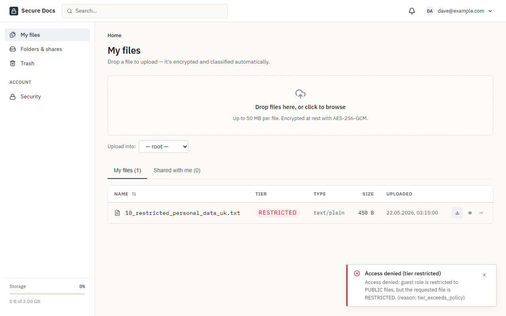

# Secure Document Storage

[](https://github.com/G0frik/secure_electronic_document_storage/actions/workflows/ci.yml)

A document store that decides who can open a file based on what is in it. When a file is uploaded, a classifier reads it and assigns a sensitivity tier: public, internal, confidential or restricted. Role-based access control checks that tier on every download, preview and share. Files are encrypted at rest with AES-256-GCM.



## Features

### Classification

Text is extracted from 24 file types, including PDF, Office formats, CSV, HTML and source code. A zero-shot NLI model (DeBERTa-v3) scores the text against sensitivity categories, and Microsoft Presidio looks for structured PII such as names, emails, IBANs, card numbers and API keys. There are custom recognizers for Ukrainian РНОКПП, passport numbers and +380 phone numbers. The file gets whichever tier is higher, so a pattern match can raise the tier but never lower it. Classification runs in a Celery worker and the UI polls until it is done.

### Access control

Three roles (admin, user, guest) are checked against the four tiers. Out of the box, admins can read everything, users can read up to confidential and guests only see public files. Policies can be narrowed to a department or a group and can block specific categories, for example salary records. Each decision is logged with a reason code like `tier_exceeds_policy` or `classification_pending`.



### Sharing

Users can share files and folders with each other; a folder share covers everything inside it. External links keep only a hash of the token and have an expiry date and a use limit. Restricted files can't be shared externally unless an admin allows it.

### Encryption

Each file has its own data key, which is wrapped by a key-encryption key (KEK). Blobs record which KEK version wrapped them, so rotating the KEK means re-wrapping keys rather than re-encrypting files. Plaintext is never written to disk on upload or download. Secrets come from HashiCorp Vault, and in production the app won't start without a KEK.

### Accounts

Passwords are hashed with Argon2id, follow NIST SP 800-63B rules and are checked against Have I Been Pwned using k-anonymity. TOTP two-factor login comes with recovery codes, and the TOTP secrets are encrypted with the KEK. Sessions live server-side in Redis, CSRF uses double-submit cookies, login is rate limited, and an admin can force a user to log out.

### Other

File versions, a 30-day trash, text preview with detected entities highlighted, per-user quotas, in-app and email notifications. Audit events are written to `logs/events.jsonl` in ECS format so Filebeat or a Wazuh agent can pick them up; sample configs are in [docs/siem](docs/siem).

## Running it

You need Docker with Compose v2. The first build pulls PyTorch and spaCy, and the worker downloads the classifier model (about 1.7 GB, cached in a volume) the first time it classifies something, so the first run takes a while.

```bash
cp .env.example .env
cp .env.init.example .env.init
docker compose up -d --build
```

Once `https://localhost/readyz` responds, load the demo data:

```bash
docker compose exec backend flask seed-dev    # departments and the users below
docker compose exec backend flask seed-demo   # files, folders, shares, a share link, a pending override
```

Open https://localhost and accept the self-signed certificate. It is generated on first start into `docker/nginx/certs/`.

| Account           | Password            | Role                |
| ----------------- | ------------------- | ------------------- |
| admin@example.com | `ChangeMeNow123!`   | admin               |
| alice@example.com | `AlicePassword123!` | user, marketing     |
| bob@example.com   | `BobPassword123!`   | user, HR manager    |
| carol@example.com | `CarolPassword123!` | user, engineering   |
| dave@example.com  | `DavePassword123!`  | guest               |

`.env` holds non-secret settings. `.env.init` holds secrets that `vault-init` writes into Vault on startup; replace the example values for anything beyond local use, and set `KEK` (the file shows how to generate one). With `KEK` empty, development mode derives a key from `SECRET_KEY` and logs a warning.

Other local endpoints (bound to 127.0.0.1):

| Service       | Address                 |
| ------------- | ----------------------- |
| MinIO console | http://localhost:9001   |
| MailHog       | http://localhost:8025   |
| Vault UI      | https://localhost:8200  |
| Postgres      | localhost:5432          |

## Development

The `Makefile` wraps the common commands:

```bash
make test         # pytest in the backend container (creates docstore_test on first run)
make coverage     # same, with a coverage report
make lint         # ruff + mypy, eslint
make migrate      # alembic upgrade head
make revision     # new alembic migration
make shell-db     # psql
make clean        # stop and delete volumes
```

The backend has 317 pytest tests. They cover the API and the full role × tier access matrix, as well as tampered ciphertext and expired share links. On every push, CI lints and tests both halves, scans the whole git history with gitleaks, and starts the full stack from the example env files to check that a fresh clone still comes up.

Install the git hooks with `pre-commit install`.

### Layout

```
backend/app/
  api/              Flask blueprints
  services/         business logic; the policy decision point is policy.py
  classifier_core/  extract -> zero-shot -> Presidio -> tier
  tasks/            Celery tasks (classification, cleanup, notifications)
  models/ schemas/  SQLAlchemy models, Pydantic schemas
backend/migrations/ Alembic
frontend/src/       React + TypeScript (Vite)
docker/             nginx, Vault and Postgres init
docs/siem/          Filebeat and Wazuh snippets
```

`classify_sensitivity.py` runs the classifier on local files without the rest of the stack.

## Known limitations

- Files are encrypted and classified in memory, which is fine at the 50 MB upload cap but not for large files.
- Scanned PDFs have no OCR fallback, so they come back with no text.
- Blobs record their KEK version, but there's no rotation command yet.
- Older file versions are classified, but the UI only shows the current version's tier.
